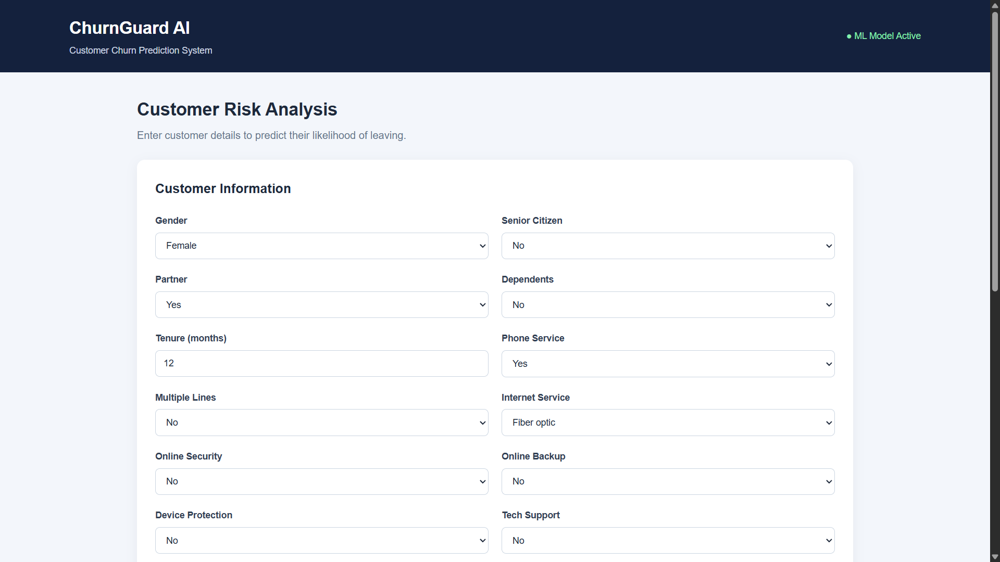
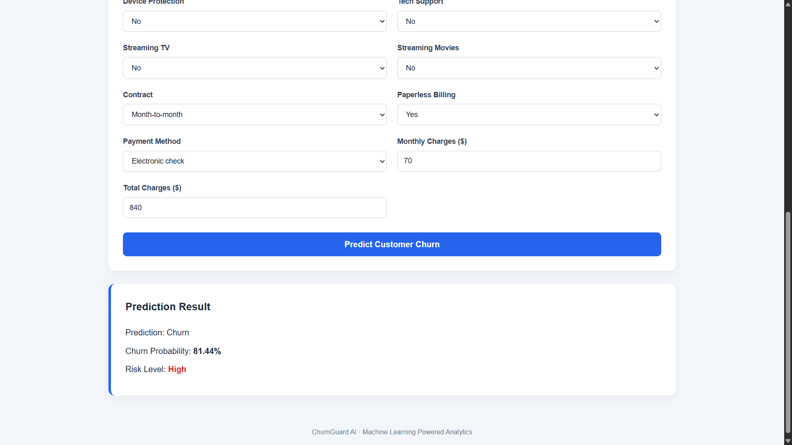
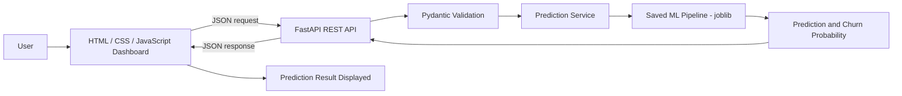

# ChurnGuard AI — Customer Churn Prediction & Retention Dashboard

ChurnGuard AI is a web application that estimates how likely a telecom customer is to leave a service. A user enters a customer's profile, subscription, and billing details in a dashboard; a trained machine learning pipeline returns a churn prediction, a churn probability, and a Low / Medium / High risk level.

**Customer churn** is when a customer stops using a company's service. Because retaining an existing customer is usually cheaper than acquiring a new one, being able to flag high-risk customers early helps a business decide where retention effort is worth spending. This project frames that problem as a binary classification task (churn / no churn) and exposes the trained model through a REST API and a simple browser interface.

---

## Live Demo

**[Open ChurnGuard AI on Render](<RENDER_URL>)**

<https://churnguard-ai-t1ig.onrender.com>` with my exact Render URL.

On the deployed dashboard you can:

- Fill in a customer's demographic, service, and billing details.
- Click **Predict Customer Churn**.
- View the predicted outcome, the churn probability, and the risk level.

The interactive API documentation generated by FastAPI is available at <https://churnguard-ai-t1ig.onrender.com/docs> .

> The service may run on a free Render tier, in which case the first request after a period of inactivity can take a short while to respond.

---

## Application Screenshot





The interface shows a **Customer Risk Analysis** page with a *Customer Information* form and a *Prediction Result* panel. An example result shown in the UI: `Prediction: Churn`, `Churn Probability: 81.44%`, `Risk Level: High`.

---

## Key Features

**Implemented (visible in the interface and project files)**

- Customer information form with 19 inputs: gender, senior citizen, partner, dependents, tenure, phone service, multiple lines, internet service, online security, online backup, device protection, tech support, streaming TV, streaming movies, contract, paperless billing, payment method, monthly charges, and total charges.
- ML-based churn prediction using a saved scikit-learn pipeline (`ml/artifacts/churn_pipeline_model.joblib`).
- Churn probability and a High / (Medium / Low) risk level shown in the result panel.
- FastAPI application with Pydantic schemas for request and response (`CustomerInput`, `PredictionResponse`).
- Prediction logic separated into a service module (`app/services/prediction.py`).
- Frontend built with HTML, CSS, and JavaScript, served by the same FastAPI application (static files mounted at `/static`).
- Root endpoint (`GET /`) returning a welcome message and a pointer to `/docs`.
- Training and analysis notebook (`ml/notebooks/customer_churn.ipynb`).

**Not implemented (possible future work)** — see [Limitations and Future Improvements](#limitations-and-future-improvements).

---

## Technology Stack

| Technology | Purpose |
|---|---|
| Python | Core language |
| Pandas, NumPy | Data loading and numerical processing |
| Scikit-learn | Model pipeline (preprocessing and classifier) |
| Joblib | Saving and loading the trained pipeline |
| Matplotlib, Seaborn | Plotting (listed in `requirements.txt`; used in the notebook) |
| FastAPI | REST API and application server |
| Uvicorn | ASGI server |
| Pydantic | Request and response validation |
| HTML, CSS, JavaScript | Dashboard user interface |
| Jupyter / IPykernel | Notebook-based experimentation |
| Git and GitHub | Version control and hosting |
| Render | Cloud deployment |

---

## Machine Learning Workflow

1. **Dataset** — the Telco customer churn CSV is stored at `data/WA_Fn-UseC_-Telco-Customer-Churn.csv`.
2. **Exploration and preprocessing** — carried out in `ml/notebooks/customer_churn.ipynb`.
3. **Feature handling** — the dashboard collects numerical features (tenure, monthly charges, total charges) and categorical features (contract, payment method, services, etc.).
4. **Training and evaluation** — performed in the notebook.
5. **Serialization** — the trained pipeline is saved as `ml/artifacts/churn_pipeline_model.joblib`.
6. **Inference** — at request time the API validates the input, passes it to `predict_churn()` in `app/services/prediction.py`, which uses the loaded pipeline to produce a prediction and churn probability.
7. **Response** — the result is returned to the frontend and displayed in the *Prediction Result* panel.

<!--
TODO before publishing: open the notebook and fill in the real details below.
Do not add numbers that are not in the notebook.

- Algorithm(s) used / compared: <fill in>
- Preprocessing (imputation, encoding, scaling): <fill in>
- Train-test split (ratio, random_state, stratification): <fill in>
- Evaluation metrics (accuracy, precision, recall, F1, ROC-AUC): <fill in from notebook output>
- Threshold used for Low / Medium / High risk: <fill in from prediction.py>
-->


---

## System Architecture



The dashboard and the API are served by the same FastAPI application.

---

## Dataset

- **File:** `data/WA_Fn-UseC_-Telco-Customer-Churn.csv`
- **Name:** Telco Customer Churn dataset (the file name matches the widely used IBM sample dataset).
- **Source link:** ` https://www.kaggle.com/datasets/blastchar/telco-customer-churn `
- **Target variable:** whether the customer churned.
- **Input features (as used by the dashboard):**
  - *Demographics:* gender, senior citizen, partner, dependents
  - *Account:* tenure, contract, paperless billing, payment method
  - *Services:* phone service, multiple lines, internet service, online security, online backup, device protection, tech support, streaming TV, streaming movies
  - *Charges:* monthly charges, total charges

The deployed application **does not train on live data**. It loads a previously trained model and uses it for inference only.

---

## Project Structure

```
project_3/
├── app/
│   ├── routers/                 # API route modules
│   ├── services/
│   │   └── prediction.py        # Loads the model and runs predictions
│   ├── static/
│   │   ├── css/style.css        # Dashboard styling
│   │   └── js/script.js         # Form handling and API calls
│   ├── templates/
│   │   └── index.html           # Dashboard page
│   ├── main.py                  # FastAPI application entry point
│   └── schemas.py               # Pydantic request/response models
├── data/
│   └── WA_Fn-UseC_-Telco-Customer-Churn.csv
├── ml/
│   ├── artifacts/
│   │   └── churn_pipeline_model.joblib   # Saved trained pipeline
│   └── notebooks/
│       └── customer_churn.ipynb          # Exploration and model training
├── .gitignore
├── main.py                      # PyCharm template file (not used by the app)
└── requirements.txt
```

---

## Installation and Local Setup

**Prerequisites:** Python 3.13 (the version used during development) and Git.

```bash
# 1. Clone the repository
git clone <YOUR_GITHUB_REPO_URL>
cd <repository-folder>

# 2. Create a virtual environment (Windows)
python -m venv .venv

# 3. Activate it
.venv\Scripts\activate          # Command Prompt / PowerShell
# source .venv/bin/activate     # macOS / Linux

# 4. Install dependencies
pip install -r requirements.txt

# 5. Start the application
uvicorn app.main:app --reload
```

Then open:

- Dashboard: `http://127.0.0.1:8000/<dashboard-route>` (see unresolved items)
- Interactive API docs: `http://127.0.0.1:8000/docs`
- Root endpoint: `http://127.0.0.1:8000/`

`requirements.txt` pins `scikit-learn==1.6.1`. Keep that version, since a joblib model should be loaded with the same scikit-learn version it was trained with.

---

## API Documentation

| Method | Path | Purpose |
|---|---|---|
| GET | `/` | Returns a welcome message and the docs path |
| GET | `/docs` | Swagger UI (auto-generated by FastAPI) |
| GET | `<dashboard-route>` | Serves the dashboard page *(confirm route)* |
| POST | `<predict-route>` | Returns churn prediction, probability, and risk level *(confirm route)* |

**Verified response of `GET /`:**

```json
{
  "message": "Welcome to ChurnGuard AI",
  "docs": "/docs"
}
```

**Prediction request / response**

The exact field names, types, and response keys are defined in `app/schemas.py` and `app/services/prediction.py`, which were not included in the supplied files. Add a verified example here, for instance by copying the request and response from the `/docs` page ("Try it out"). Use this input from the UI as the sample values:

| Field | Example value |
|---|---|
| Gender | Female |
| Senior Citizen | No |
| Partner | Yes |
| Dependents | No |
| Tenure (months) | 12 |
| Phone Service | Yes |
| Multiple Lines | No |
| Internet Service | Fiber optic |
| Online Security | No |
| Online Backup | No |
| Device Protection | No |
| Tech Support | No |
| Streaming TV | No |
| Streaming Movies | No |
| Contract | Month-to-month |
| Paperless Billing | Yes |
| Payment Method | Electronic check |
| Monthly Charges | 70 |
| Total Charges | 840 |

With these values the deployed UI returned: **Churn, 81.44% probability, High risk**.

---

## Deployment

The application is deployed on [Render](https://render.com) as a single web service. FastAPI serves both the REST API and the static dashboard, so no separate frontend host is needed.

| Setting | Value |
|---|---|
| Build command | `pip install -r requirements.txt` |
| Start command | `uvicorn app.main:app --host 0.0.0.0 --port $PORT` |

Because the trained model file (`ml/artifacts/churn_pipeline_model.joblib`) is loaded at runtime, make sure it is committed to the repository and not excluded by `.gitignore`.

---

## Limitations and Future Improvements

**Current limitations**

- The model is a static, pre-trained artifact; there is no retraining or monitoring.
- The risk thresholds and model metrics are not documented here.
- No automated tests are included in the supplied files.
- The model was trained on a public sample dataset and should not be treated as a production decision system.

**Possible future improvements**

- Churn analytics charts and dataset summary endpoints.
- Model comparison view.
- Explainability (for example SHAP) to show which features drive each prediction.
- Automated tests for the API and prediction service.
- Model monitoring and a retraining workflow.
- Stricter input validation and clearer error messages in the UI.

---

## Learning Outcomes

This project demonstrates:

- Building and serializing a scikit-learn pipeline.
- Serving a model through a FastAPI REST API with Pydantic validation.
- Separating API, schema, and prediction-service code.
- Integrating an HTML/CSS/JavaScript frontend with a Python backend.
- Deploying a full-stack ML application on Render.

---

## Author

**< Abhishek Kumar >** — Final-year B.Tech Computer Science (Data Science specialization) student.
GitHub: `<https://github.com/Abhishek-995312/project_3>`

## Acknowledgements

- Telco Customer Churn dataset — `<https://www.kaggle.com/datasets/blastchar/telco-customer-churn>`.
- FastAPI, scikit-learn, Pandas, and the open-source community.
